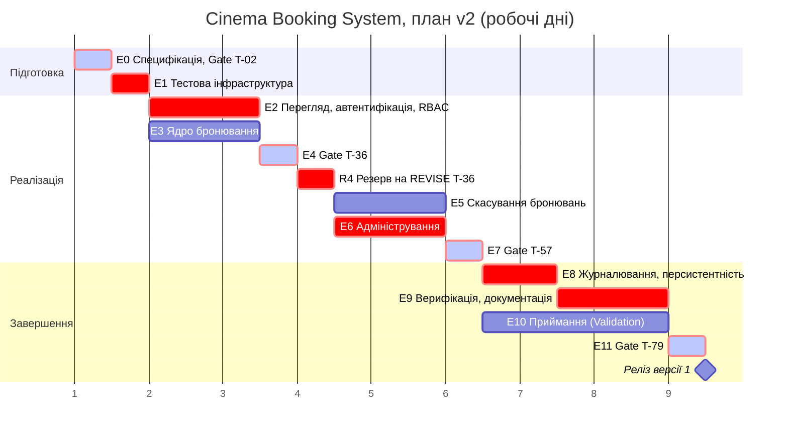

# Діаграма Ганта Cinema Booking System (за plan.md)

Шкала в робочих днях проєкту (1, 2, 3 ...), вихідні не показано. Один робочий день = 4 год людського часу, півдня = 2 год. Gate-точки виділено світлішим кольором, етапи критичного шляху червоним (Gate на критичному шляху мають червону рамку).

